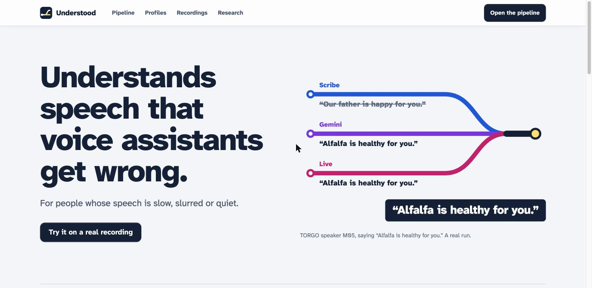
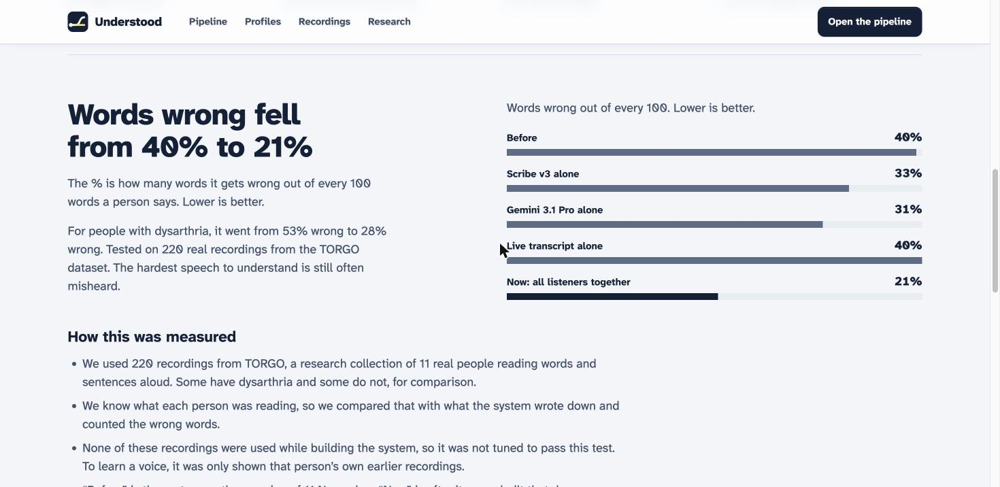
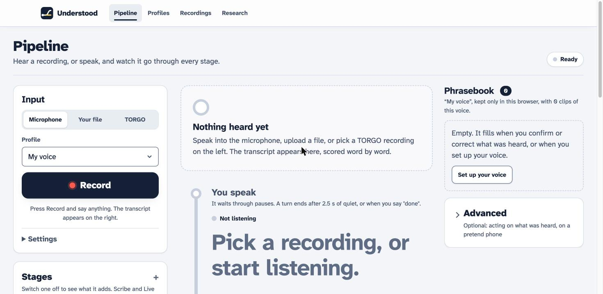
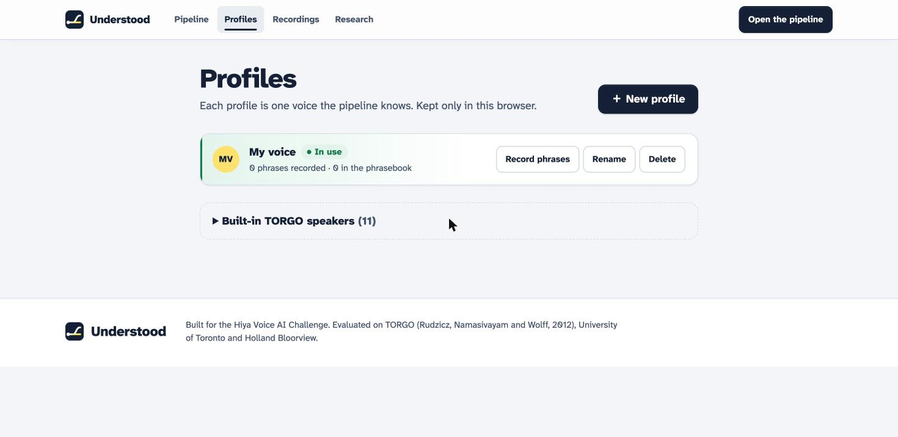
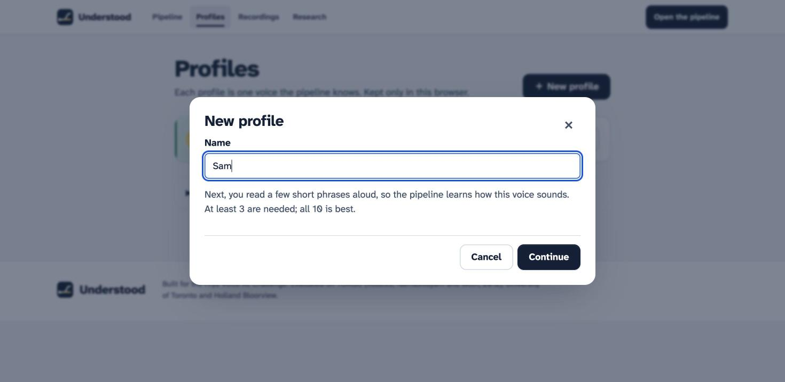
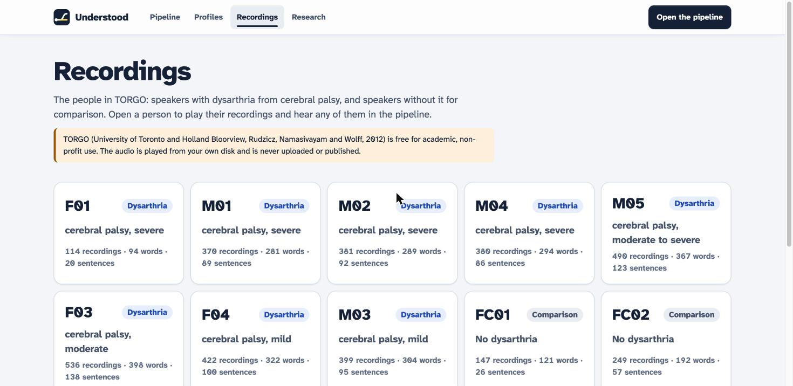
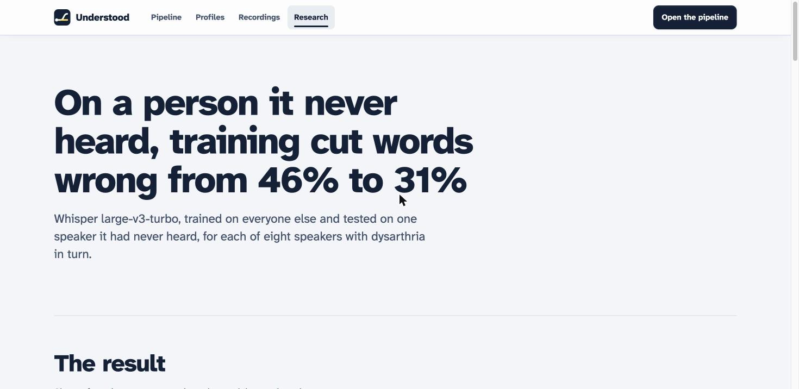

# Understood

**A voice assistant that understands speech other assistants get wrong.**



Understood is for people with **dysarthria**: speech made slow, slurred or quiet by cerebral palsy, ALS, Parkinson's, MS or a stroke. It takes one sentence, from the microphone, an audio file or a real recording, and writes down what the person said. Every step shows on screen as it happens, with real timings, and the transcript is marked word by word against what was really said.

It is built in two steps:

1. **Now: personalised to each person.** A person makes a **profile** by reading a few short phrases aloud (at least three). From then on, the listeners are shown that person's own clips and a phrasebook of their past mishearings, so the pipeline learns how they speak with no training at all.
2. **Next: one model for as many people with dysarthria as possible.** A speech model fine-tuned on recordings of dysarthric speech. On speakers it had **never heard**, it cut words wrong from 46% to 31% (the [Research page](#the-research-page-a-tuned-model)).

**Live:** https://understood.chinmayraj.workers.dev (locked with a keyword sent with the submission). It is my submission for the Hiya Voice AI Challenge (Accessibility track). The write-up is [WRITEUP.md](WRITEUP.md), and the AI tools I used are described in [ai.md](ai.md).

## Results



On 220 held-out recordings from TORGO (11 people, 8 with dysarthria), the pipeline gets **20.6%** of words wrong, down from 39.9%. For speakers with dysarthria it went from 52.9% to **27.6%**. Each listener on its own gets 31% to 41% wrong on the same clips; hearing a sentence several ways and merging is what brings it down. The % is how many words are wrong out of every 100 a person says, so lower is better. Details: [Does it work?](#does-it-work-transcription-accuracy)

## Try it in two minutes

1. Open https://understood.chinmayraj.workers.dev and enter the keyword. The page remembers it.
2. Click **Open the pipeline**.
3. Under **Input**, **Microphone** is first: press **Record**, say a sentence, and press **Stop**. The sentence is heard by every listener, and the transcript appears on the right.
4. Or choose **Your file**, upload a short recording (WAV, MP3, M4A, OGG or WebM, up to 60 seconds), optionally type what was said to see each word marked right or wrong, and click **Hear it**.
5. To make the pipeline yours, open **Profiles**, click **New profile**, give it a name and read at least three phrases. The microphone then hears you as that profile.

The TORGO recordings are not available through the link, because their licence keeps them on my computer. To use them, run it locally (below) and fetch TORGO with `eval/scripts/fetch_torgo.sh` (about 1 GB).

## The site

### Pipeline (`#/pipeline`)



Input on the left, in three tabs:

- **Microphone.** Choose a profile (the list ends with **Create new profile**), then one **Record / Stop** button. Stop in the middle of a sentence still sends that sentence through. Listening settings are folded away under **Settings**. If the browser refuses the microphone, the page says exactly where to allow it and starts listening by itself once you do.
- **Your file.** Upload audio and choose **Hear it as**: one of your profiles or a TORGO speaker.
- **TORGO**, in three steps:
  1. **Speaker.**
  2. **Profile clips:** the clips this speaker's voice is learned from. By default these are the evaluation's 20 set-up clips; **Change** lets you pick others (3 to 40).
  3. **Clip to transcribe:** choose a phrase, or **Pick one at random** (always a test clip). The profile clips are never in this list, so a clip is never transcribed by a profile that learned from it.

In the middle: the transcript in large type, scored word by word when what was said is known, then each stage with its timing. **Stages** switches turn off a stage (the Gemini listeners, their example clips, the phrasebook, the known phrases, Claude's repair), so you can hear the same clip again and compare the two results side by side. On the right: the phrasebook of the profile in use. Under **Advanced**, **Act on what I say** sends speech to a pretend phone that acts or asks first.

### Profiles (`#/profiles`)

<p>
  
  
</p>

Each profile is one person's voice: its own phrasebook and voice clips, kept in its own database in this browser, so profiles never mix.

- **New profile** is a short dialog: a name, then phrases read aloud with **Record**, **Stop**, **Re-record** and **Next**. **Save profile** appears only after three phrases; cancelling deletes the half-made profile and what it recorded.
- **Record phrases** adds more to an existing profile; **Cancel** undoes everything that session recorded and learned.
- **Use**, **Rename** and **Delete** do what they say. The profile in use is the one the microphone hears and learns into.
- The TORGO speakers are listed too, as built-in profiles set up automatically from their own clips.

### Recordings (`#/recordings`)



A card for each TORGO speaker: their condition and severity, and how many words and sentences they recorded. Open one (`#/recordings/F01`) for every recording of that person: play it, search, filter words or sentences, hear any of them in the pipeline, and, for the clips the evaluation tested, see what each recogniser heard and what the pipeline decided. The audio is served only by the local server, only to this computer; a hosted copy has no such route.

### Research (`#/research`)



What training a speech model on dysarthric speech did. See [below](#the-research-page-a-tuned-model).

## What happens to one sentence

The same steps for the microphone, a file or a TORGO clip:

1. **Record.** The browser takes one sentence and sends it on, with the live transcript (ElevenLabs Scribe realtime) written while it is spoken or played.
2. **Hear it several ways, at the same time** (each listener gets up to 15 seconds):
   - **ElevenLabs Scribe v3**, given no word list.
   - **Gemini 3.1 Pro** (through OpenRouter), first shown 5 earlier clips of this person with what they said.
   - **Gemini 4 Carbon**, shown the same clips: a second opinion that makes different mistakes.
   - **Scribe realtime**, the live transcript, as one more vote.
3. **Phrasebook** (plain code, no model). It looks for mishearings already learned for this person ("heard *Mum sis*, meant *message Sam*").
4. **Repair. Claude Opus 5.5** reads all the transcripts and any phrasebook match and writes one final transcript, with a confidence and a one-sentence reason (up to 8 seconds).

Agreement between the listeners is the confidence signal: words they disagree on light up. Nothing is acted on: with **Act on what I say** switched on, speech goes instead to a faster path (Scribe v2, Gemini 3.8 Flash, Claude Haiku 5.5), then fixed rules in code ([`web/shared/rules/decider.ts`](web/shared/rules/decider.ts)) decide whether the pretend phone acts, asks a yes/no question, offers a choice or asks to repeat. **Claude alone never makes it act**, and anything that reaches another person always asks first.

Where the phrasebook comes from: reading phrases when a profile is made (the phrase is known, so every mishearing becomes a "heard → meant" pair), spoken corrections when acting is on ("no, Sam"), and, for a TORGO speaker, their own set-up clips.

## Run it

You need [Node.js](https://nodejs.org/) (built and tested with v24.13.0), a microphone, and three API keys.

| Key | What it is for |
|---|---|
| `ELEVENLABS_API_KEY` | Scribe (batch and realtime) and the spoken replies. It needs Speech to Text and Text to Speech access |
| `OPENROUTER_API_KEY` | Gemini hearing the audio (3.8 Flash for speech; 3.1 Pro and 4 Carbon for recordings) |
| `ANTHROPIC_API_KEY` | Claude: the repair step (Haiku 5.5 for speech, Opus 5.5 for recordings), and choosing the pretend-phone action |
| `ELEVENLABS_VOICE_ID` | Optional. The voice the assistant speaks in; a default is used without it |

1. Get the code and enter the folder.

```bash
git clone <repository-url> understood
cd understood
```

2. Create the settings file at the repo root and fill in the three keys. `.env` is ignored by git.

```bash
cp .env.example .env
chmod 600 .env
open -e .env
```

3. Install and start the website. This runs the page on port 5173 and the API server on port 8787.

```bash
cd web
npm install
npm run dev
```

4. Open http://localhost:5173 and click **Open the pipeline**. Under **Input**, choose **Microphone**, press **Record**, allow the microphone and say a sentence; press **Stop** (or pause for 2.5 seconds) and the transcript appears. Or choose **Your file**, or **TORGO** (this needs the data: `eval/scripts/fetch_torgo.sh`).

To share it with someone without giving them API keys, set `ACCESS_KEY` in `.env` and expose port 5173 (for example `cloudflared tunnel --url http://localhost:5173`). Every paid route then needs the keyword, which the page asks for once. The TORGO recordings stay local: requests that come through a tunnel or proxy are refused.

The server keeps the keys. They never reach the browser: the page gets only a short-lived token for the live transcript. Each visitor is limited to 20 sentences a minute (90 on the local server, because setting up a TORGO speaker's voice hears 20 clips at once). If a key is missing, the server says so when it starts, and that stage shows as failed on the page.

## The Research page (a tuned model)

`#/research` shows what fine-tuning a speech model (Whisper large-v3-turbo) on recordings of dysarthric speech did:

- **On people it had never heard** (leave one speaker out: trained on everyone else, tested on the one left out, for each of 8 speakers with dysarthria in turn), words wrong fell from **46.4% to 31.4%** over 940 clips; single words from 83% to 45%.
- **On prompts it never trained on**, for speakers it had trained on, words wrong fell from 35.6% to 24.6% ([`docs/FINETUNE_RESULTS.md`](docs/FINETUNE_RESULTS.md), method in [`docs/FINETUNE_PLAN.md`](docs/FINETUNE_PLAN.md)).

The numbers are in `web/public/research/results.json`, so they show on the hosted site too. On your own computer the page can also try a random never-trained clip with the tuned model. That needs the TORGO data, the saved runs in `train/runs/` (not in this repository: the weights were trained on TORGO), and the model service:

```bash
cd train
uv run python serve.py
```

It keeps the model in memory and answers only this computer, on port 8791. A clip takes about 1.5 seconds on an M4. The training code is Python and lives only in `train/`; the product stays TypeScript.

## Run the tests

```bash
cd web
npm test            # 355 tests in 33 files, no network
npm run typecheck
```

Last run on 20 Nov 2026: all 355 passed, and the typecheck was clean. The decision rules and phrasebook matching are ported from the Swift implementation the 9 Nov evaluation ran against (not included in this submission), and give the same answer on all 3,902 comparison cases.

A live check against real services (it uses the keys and costs a fraction of a penny):

```bash
cd web
npm start           # API server only, in one terminal
# in another terminal, make a test clip and send it through every stage:
say -o x.aiff "message Sam running late" && afconvert -f WAVE -d LEI16@16000 -c 1 x.aiff x.wav
npx tsx tests/live.smoke.ts x.wav
```

## Does it work? Transcription accuracy

On 11 November the pipeline's transcription was measured end to end, the way the pipeline page hears a recording, on **held-out TORGO test clips**: two samples from a fixed half of the test clips, set aside before any change was made and never used to choose anything. 220 clips from 11 speakers, 8 with dysarthria.

| Held-out, 220 clips | Before (11 Nov morning) | Now |
|---|---|---|
| Words wrong, all | 39.9% | **20.6%** |
| Single words | 65.9% | 36.3% |
| Sentences | 33.9% | 16.9% |
| Speakers with dysarthria | 52.9% | 27.6% |
| Every word right | 43% | 64% |

Each listener alone gets 31% to 41% wrong on the same clips; merging them is what brings it to 21%. On the 186 held-out clips whose phrase the speaker never said during setup, it fell from 43.5% to 22.4%. The two samples differ (18.7% and 22.5% after), which is the honest spread. What changed, the evidence behind each choice (including a comparison of 13 speech recognisers and 5 audio models), how it was measured, and the limits are in [`docs/TRANSCRIPTION.md`](docs/TRANSCRIPTION.md). The scripts are in `web/scripts/` (`evalTranscription.ts` runs the whole pipeline).

## The earlier evaluation: deciding when to act

The first version of the pipeline was measured on **TORGO**, recordings of people with dysarthria (mostly from cerebral palsy) made by the University of Toronto. Each speaker's earlier recordings were used to set them up; their later recordings were the test, so no clip was in both. There were 121 test clips. The full method and results are in [`eval/README.md`](eval/README.md).

| Setup (each adds to the one above) | Words wrong | Acted, and was right | Acted, and was **wrong** | Asked first |
|---|---|---|---|---|
| Scribe alone | 34% | 0% | 0% | 98% |
| + hints | 29% | 0% | 0% | 98% |
| + Gemini with the person's own clips | 29% | 39% | 7% | 54% |
| + third vote and Claude's repair | 27% | 37% | 4% | 59% |
| + phrasebook (the full pipeline) | **25%** | 34% | **2%** | 64% |

The "+ hints" row is history: since 19 Nov no recogniser is given hints (see `DECISIONS.md`).

On phrases the person had said before (66 clips), words wrong fell from 38% to **19%**.

How to read this: with Scribe alone the rules almost always asked, because one recogniser has nothing to agree with. Adding Gemini let the pipeline act on 39% of clips, but it was wrong on 7%. The third vote, Claude's repair and the phrasebook brought wrong actions down to 2%, while still acting correctly on about a third of sentences without needing to ask.

**Limits of the evaluation:** one dataset, a handful of speakers, single runs, and mostly single words and short phrases. TORGO is free for academic, non-profit use. It is used here only to evaluate; its audio is never committed or published, and the page shows text and timings only.

That run used the Swift implementation, which is not included here. To measure the website's own pipeline on TORGO (downloads about 4.4 GB once; uses your API keys):

```bash
eval/scripts/fetch_torgo.sh
cd web
npx tsx scripts/evalTranscription.ts --split dev --per-speaker 10
```

## Privacy

- **Profiles, recordings and phrasebooks stay in the browser** (IndexedDB, one database per profile), because speech recordings of a disabled person are health data. Each request carries only the clips it needs, and the server stores nothing. Deleting a profile deletes its database.
- Audio goes to ElevenLabs (Scribe) and to Google's Gemini through OpenRouter, and the transcripts go to Anthropic (Claude), only while a sentence or recording is being understood. A TORGO clip heard in the pipeline goes to the same services, as it did in the evaluation; it is never stored by the server or added to the repo.
- Keys stay on the server and are never logged. The page gets only a short-lived token for the live transcript.

## Safety rules it follows

These apply when **Act on what I say** (under Advanced) is on, so speech is acted on by the pretend phone:


- Nothing is acted on when the pipeline is unsure. That rule is code, not a prompt, so it holds when the model is wrong.
- Anything that reaches another person (a message or a call) always needs a yes.
- A yes counts only if it is just a yes, said after the question finished playing. "Okay, message Sam instead" is not a yes to "Message Mum?". Questions expire after 60 seconds.
- The model never chooses who a message goes to. "Message Mallory" does nothing unless Mallory is a known contact.
- "Stop" or "cancel" on its own always acts at once, because stopping is always safe.
- If a service is down, the pipeline goes on with what is left and asks more often. If everything is down, it says "I can't hear properly right now."

## Known limits

- **Hosted on Cloudflare Workers** at https://understood.chinmayraj.workers.dev, locked with a keyword (`ACCESS_KEY`). Deploy with `npm run build` then `npx wrangler deploy`; keys are Worker secrets. The TORGO recordings are never served to other machines.
- **Speed.** A sentence takes about 6 to 15 seconds after it ends, because the strongest listeners are slow; Gemini with example clips is erratic (1.4 to 14 seconds for the same request). Acting on speech uses faster models (about 3 to 6 seconds).
- **Hard cases.** Isolated single words stay hard (36% wrong held-out), homophones such as "knew" and "new" cannot be told apart without context, and the most severe speakers (M02, M04) are still misheard about half the time.
- **Profiles live in one browser.** They do not sync between devices, and clearing the browser's data deletes them.
- **Not tested with a person with dysarthria using it live.** The evaluation used real recordings, played in offline; the live checks used synthetic voices.
- **English only, and a pretend phone.** Nothing on the page reaches a real person.
- The per-visitor limit is kept in memory, which is enough locally but not for a public deployment.

## Map of the repo

```
web/                  the website (submission)
  src/                the pages (React): pages/ (home, pipeline, profiles, research),
                      components/, the microphone, profiles and storage (storage/)
  server/             the API (Hono): /api/understand, /api/realtime-token, /api/speak,
                      /api/act; the listeners and the repair; dataset.ts, the local-only
                      TORGO route
  shared/rules/       the decision rules and phrasebook matching, ported from Swift
  tests/              Vitest: 355 tests, plus live.smoke.ts
train/                fine-tuning a speech model on dysarthric speech (Python)
eval/                 the TORGO evaluation: method, scripts, results (no audio)
docs/                 SPEECH_PLAN.md (the design), WEB_PLAN.md (the website),
                      TRANSCRIPTION.md, FINETUNE_*.md, images/ (README screenshots)
DECISIONS.md          every significant choice, what was rejected, and why
```

This repo holds the website, the evaluation and the training code. An earlier Mac prototype, built the first week, was removed for the submission; its history is in `DECISIONS.md`.

## Credits

- **ElevenLabs** (Scribe v2, v3 and realtime speech-to-text, and text-to-speech), **Google Gemini** (3.8 Flash, 3.1 Pro, 4 Carbon) through **OpenRouter**, and **Anthropic** (Claude Haiku 5.5 and Opus 5.5).
- **Whisper large-v3-turbo** (OpenAI), the model fine-tuned on the Research page.
- **TORGO**: Rudzicz, Namasivayam and Wolff (2012), *The TORGO database of acoustic and articulatory speech from speakers with dysarthria*, Language Resources and Evaluation 46(4):523–541.
- Fonts: Atkinson Hyperlegible, self-hosted (see `web/public/fonts/README.md`).
- The earlier Mac prototype (not included here) adapted parts of **Clicky** by Farza (MIT).
